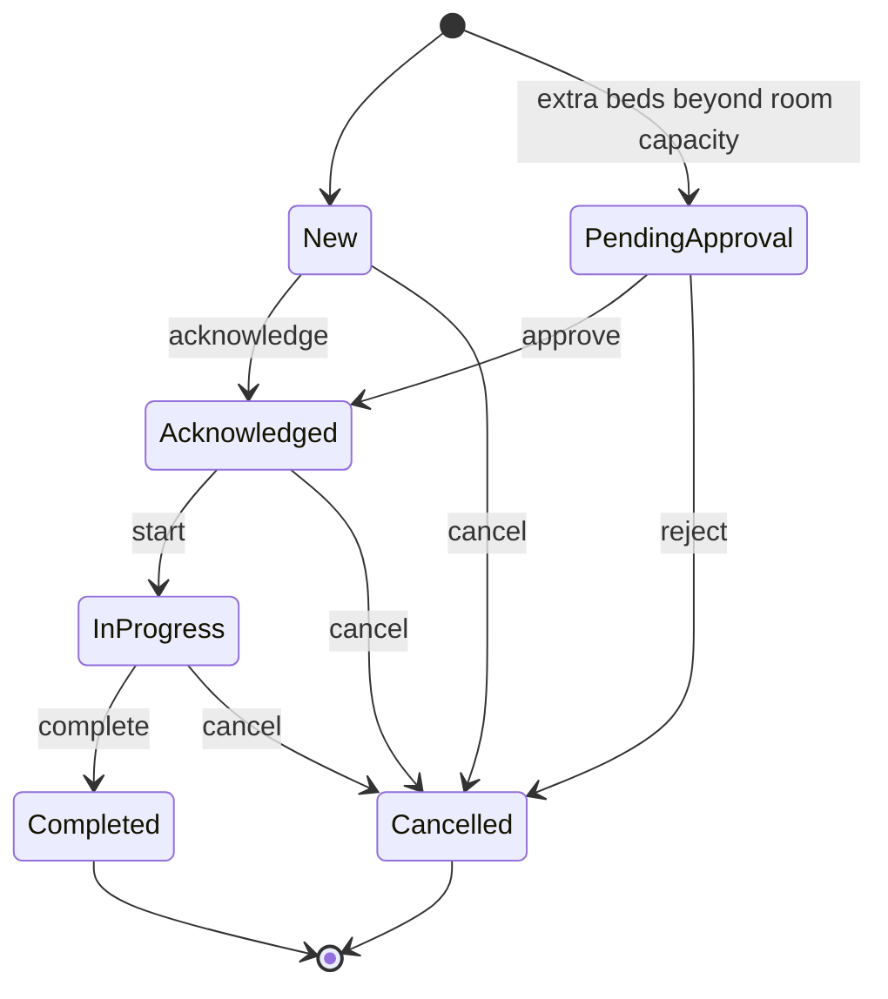

# Architecture

How Roomflow is put together, and why. The [README](../README.md) covers what the app does and how to run it. If Vue is new to you, start with [Reading this code without knowing Vue](#reading-this-code-without-knowing-vue).

## Tech stack

| Choice                                  | Why                                                                                                                   |
| --------------------------------------- | --------------------------------------------------------------------------------------------------------------------- |
| Vue 3.5 + TypeScript (strict)           | Single-file components with `<script setup>`; `vue-tsc` type-checks the templates as well as the scripts              |
| Bun 1.3.5                               | Runtime and package manager; scripts run on the Bun runtime (`bunx --bun`), so Node isn't needed                      |
| Vite 8                                  | Dev server and production bundling                                                                                    |
| Tailwind CSS v4 + shadcn-vue on Reka UI | Utility styling plus accessible headless components that live in this repo (`src/components/ui`), free to edit        |
| TanStack Vue Query v5                   | All server state: caching, polling, optimistic updates                                                                |
| Vue Router 5                            | Hotel-scoped routes, URL-driven list state, a routed details drawer, one navigation guard for sign-in                 |
| VueUse 14                               | The small reactive utilities every Vue app ends up needing: storage-backed refs, color mode, a shared clock, debounce |
| vee-validate 4 + Zod 4                  | Schema-first forms; Zod also validates the session and demo settings read back from `localStorage`                    |
| MSW v3 (browser)                        | The backend: intercepts real `fetch` calls at the network boundary, in dev and in the deployed build                  |
| Unovis (via shadcn-vue charts)          | The orders-by-hour chart; lazy-loaded with the dashboard route                                                        |
| Vitest 5 + Vue Testing Library          | Unit tests for the domain and mock database, component and composable tests for the UI, in happy-dom                  |
| Cloudflare Workers (static assets)      | Hosting: the built files served from the edge                                                                         |

Where two libraries could do a job, I took the one most Vue teams use. In November 2026 that meant TanStack Vue Query (4.3M npm downloads a month) over Pinia Colada (0.7M), Reka UI under shadcn-vue (11.3M) over a styled kit like Vuetify (5.1M) or PrimeVue (3.9M), and vee-validate (5.6M) over TanStack Form's Vue adapter (0.4M).

## Layers

Dependencies point one way. The network boundary is where a real backend would replace the mock one.

```
┌────────────────────────────────────────────────────────────────────┐
│ UI            src/app, src/features/*/*.vue, src/components        │  renders state, emits events
├────────────────────────────────────────────────────────────────────┤
│ Server state  src/features/*/queries.ts, mutations.ts              │  query keys, caching, optimistic updates
├────────────────────────────────────────────────────────────────────┤
│ API client    src/lib/api-client.ts + src/features/*/api.ts        │  typed endpoints, ApiError
├────────────────────────────────────────────────────────────────────┤
│ Domain        src/domain: plain TypeScript, imports only itself    │  types, lifecycle, SLA, list queries, metrics
└────────────────────────────────────────────────────────────────────┘
     ↕ network boundary (fetch)
┌────────────────────────────────────────────────────────────────────┐
│ Mock server   src/mocks (MSW): reuses the domain for validation,   │  started only from main.ts
│               filtering and metrics                                │
└────────────────────────────────────────────────────────────────────┘
```

Rules the code follows:

- `src/domain` imports nothing outside itself: no Vue, no libraries. Every rule in it is unit-tested without a DOM.
- All HTTP goes through `request()` in `src/lib/api-client.ts`. Each feature's `api.ts` defines typed endpoint functions. No `fetch` in components.
- The mock server enforces the same rules the UI uses (`canTransition`, `applyOrderQuery`, `computeMetrics`), so the two sides of the wire can't disagree.
- Only `main.ts` imports from `src/mocks`.
- `src/app` is the composition layer (router, app shell, route-level screens). Features don't import from it; shared URL building lives in `src/lib/paths.ts` for that reason.

### Deliberately not doing

No Pinia: TanStack Query and the URL already hold all the state there is, and the two values left over (the session and the demo settings) are one storage-backed ref each. No repository pattern or DI container. No state-machine library for a six-status transition map, because a typed record does it. No barrel files in app code. An abstraction has to make something testable or swappable to earn its place.

## Folder structure

```
src/
  main.ts       # starts the mock API, then mounts the app with its plugins
  App.vue       # root component: the routed page, the toaster, the error boundary
  app/          # router and its sign-in guard, app shell, hotel scope, status screens
  components/
    ui/         # shadcn-vue primitives (CLI-generated, then themed)
    shared/     # badges, RoomTag, MoneyAmount, BrandMark, empty/error/stale-data states, page header
  domain/       # business rules and shared types, fully unit-tested
  features/
    auth/       # login page, session, login schema, post-sign-in redirect
    dashboard/  # today summary, orders chart, needs-attention list, top services (lazy-loaded route)
    hotels/     # hotel list query, current-hotel provider, hotel switcher
    orders/     # list page, toolbar, table and cards, details sheet, actions, confirm dialog
    simulator/  # demo controls and the incoming-order simulation
  lib/          # api-client, config, paths, query client, demo settings, formatters, clock, theme
  mocks/        # MSW worker, handlers, in-memory db, hotel profiles, seed data
  test/         # test setup, factories, render helpers
```

Each feature keeps the same file roles: `api.ts` (endpoints), `queries.ts` (query keys and read composables), `mutations.ts` (write composables), then components.

## Domain model

```ts
interface Hotel {
  id: string // "harborline", used in URLs and API paths
  code: string // "HL", prefixes the hotel's order IDs
  name: string
  city: string
}

type ServiceType =
  "Room Service" | "Housekeeping" | "Laundry" | "Extra Bed" | "Spa & Massage"
type OrderStatus =
  | "New"
  | "Pending Approval"
  | "Acknowledged"
  | "In Progress"
  | "Completed"
  | "Cancelled"
type PaymentStatus = "Paid" | "Pending" | "Failed"

interface Order {
  id: string // "HL-1042"
  hotelId: string
  guestName: string
  roomNumber: string
  service: ServiceType
  quantity: number
  amount: number // USD; complimentary services are 0
  specialRequest: string
  orderTime: string // ISO timestamp
  status: OrderStatus
  paymentStatus: PaymentStatus
}
```

### Order lifecycle

One typed transition map (`src/domain/order-status.ts`) drives everything. The UI renders only the actions the map allows, and the mock API rejects anything else with HTTP 422. A test keeps the action list and the transition map in agreement.



Each action carries its UI metadata: label, past-tense label for the toast, intent, and whether it needs confirmation. Destructive actions (Cancel, Reject) always confirm.

### Business rules (`src/domain`)

- **SLA.** An order breaches its SLA when it stays in `New` longer than its service's target (`SLA_TARGET_MINUTES`): Room Service 10 min, Spa & Massage 15, Housekeeping 20, Extra Bed 20, Laundry 30. Later statuses count as in hand.
- **Approval.** `initialStatusFor()` sends an Extra Bed request above `EXTRA_BED_CAPACITY` (2) to `Pending Approval` instead of `New`.
- **Payment follow-up.** `needsPaymentFollowUp()` (`src/domain/payment.ts`) is true while a declined payment still has to be collected: the order isn't cancelled and isn't complimentary. While it holds, `actionsForOrder()` makes Acknowledge and Approve ask for confirmation first; later steps stay one click. It's also the only time the API accepts "Mark payment collected".
- **Metrics** (`computeMetrics`, "today" = local calendar day):
  - active guests = distinct rooms with a non-cancelled order today
  - open orders = everything not Completed or Cancelled
  - revenue today = paid, non-cancelled orders today
  - average order value = that revenue over the paid orders behind it, with complimentary $0 orders left out
  - needs attention = SLA breaches, then pending approvals, then orders where `needsPaymentFollowUp()` holds. A completed order whose payment failed still owes money, so it stays listed until the payment is collected.

## Mock API

MSW intercepts `fetch` in a service worker, so the app is written exactly as it would be against a real backend, and the deployed build ships the same mock. MSW's Vite plugin serves the worker script in dev and adds it to the build, so no generated file is committed. Every route is scoped to a hotel:

| Endpoint                                             | Behavior                                                                                                                                         |
| ---------------------------------------------------- | ------------------------------------------------------------------------------------------------------------------------------------------------ |
| `GET /api/hotels`                                    | The hotels this account can work in                                                                                                              |
| `GET /api/hotels/:hotelId/orders`                    | Query params `search`, `status`, `service`, `payment`, `sla`, `sort`, `page`, `pageSize`. Returns `{ items, total, page, pageSize, totalPages }` |
| `GET /api/hotels/:hotelId/orders/:orderId`           | One order, or 404                                                                                                                                |
| `PATCH /api/hotels/:hotelId/orders/:orderId/status`  | Body `{ status, reason? }`; checked against the transition map; 422 with a message when illegal                                                  |
| `PATCH /api/hotels/:hotelId/orders/:orderId/payment` | Body `{ status: "Paid" }`: records a collected payment; 422 when there is nothing to collect, 400 for any other status                           |
| `GET /api/hotels/:hotelId/metrics`                   | Dashboard metrics and the needs-attention list                                                                                                   |
| `POST /api/hotels/:hotelId/demo/orders`              | One realistic incoming order (the live simulation)                                                                                               |
| `POST /api/demo/reset`                               | Reseeds every hotel                                                                                                                              |

**Tenant isolation.** A second catch-all handler returns 404 for an unknown hotel before any hotel route runs. `src/mocks/db.ts` is one orders table with a `hotelId` column, and every read is scoped to a hotel. An order that belongs to another hotel returns the same 404 as one that doesn't exist, so the API never confirms what another tenant holds. `src/mocks/db.test.ts` covers this.

**Simulated conditions.** A catch-all handler runs before every endpoint (in MSW, a handler that returns nothing passes the request on). It adds 250 to 600 ms of latency normally and about 2 s in "slow network" mode, and returns HTTP 500 for every request in "API errors" mode. The settings live in `src/lib/demo-settings.ts` and are toggled from the demo controls in the header.

**Seed data.** Three fictional hotels with their own room layouts and volumes: Harborline Hotel (118 orders), Cedarfall Lodge (68) and Saltmarsh House (38). Each has its own PRNG seed, and timestamps are relative to "now", so every hotel opens mid-shift with SLA breaches, a pending approval and failed payments in view. Hand-placed orders guarantee those stories, and a test checks that every hotel shows them. Changes live in memory for the session; a full reload reseeds.

**Replacing the mock with a real API** takes these steps:

1. Point `apiBaseUrl` in `src/lib/config.ts` at the real API.
2. Remove `enableMocking()` from `src/main.ts`, the `msw()` plugin from `vite.config.ts`, and delete `src/mocks`.
3. Remove the demo layer, which only exists for the mock:
   - `src/features/simulator`: `DemoControls` in `HotelScope.vue` and `useOrderSimulator` in `AppShell.vue`
   - `src/lib/demo-settings.ts`
   - the "turn off simulated errors" button in `src/app/HotelsGate.vue`
4. Replace the mock login in `src/features/auth/session.ts` with real authentication.

Query composables, components and the domain don't change.

## State management

| Kind         | Where it lives                         | Examples                                                   |
| ------------ | -------------------------------------- | ---------------------------------------------------------- |
| Server state | TanStack Query only                    | hotels, orders list, order detail, metrics                 |
| View state   | the URL                                | current hotel (path), search, filters, sort, page (query)  |
| Preferences  | `localStorage` refs, checked on read   | session, theme, demo settings, last-used hotel             |
| UI state     | a `ref` in the component that needs it | open dialogs, the search draft, the order awaiting confirm |

Typing in the search box replaces the current history entry, and a filter change adds one, so Back undoes filters, not keystrokes.

**Query keys** start with the hotel, so each hotel has its own cache and switching back to one is instant:

- `["hotels"]`
- `["orders", hotelId, "list", params]`
- `["orders", hotelId, "detail", id]`
- `["metrics", hotelId]`

The orders list and metrics poll every 30 s, as a stand-in for a push transport.

**Queries follow the hotel.** A query composable takes its arguments as getters, `useOrders(() => hotel.value.id, params)`, and builds its key in a `computed`. When the hotel or a filter changes, the key changes and the right data loads, with no manual refetch. Passing the plain string would freeze the query on the hotel it was created with.

The list keeps the previous page on screen while the next loads, but only within one hotel. After a hotel switch the old hotel's rows never stand in for the new one's (`src/features/orders/queries.ts`).

**Status changes** (`src/features/orders/mutations.ts`):

- **Quick, reversible steps** (Acknowledge, Approve, Start, Complete) are optimistic. The new status shows at once. On failure only that order is put back, so a change to another order made in the meantime survives, and a toast says the change was reverted.
- **Confirmed steps** (Cancel, Reject) wait for the server. The dialog stays open with a spinner and shows a failure inline, keeping the typed reason.
- The confirm dialog lives once per page in `ConfirmActionProvider`, above the list. It keeps its own copy of the order, so a row that moves or disappears in a refresh doesn't take the dialog with it.
- `useIsOrderUpdating()` reads the pending mutations from TanStack Query's own cache, so the row menu, the drawer and the dialog disable together without sharing any state of their own.

**Shared values without a store.** Three values are needed all over the app and by code outside any component:

- The **session** and the **demo settings** are VueUse `useStorage` refs wrapped in `createGlobalState`, so every caller gets the same ref. The router guard and the mock API read them directly.
- The **theme** is VueUse's `useColorMode`, also behind `createGlobalState`.

**One clock.** `useNow()` (`src/lib/use-now.ts`) is VueUse's `useNow` behind `createSharedComposable`. Every SLA badge and relative time reads the same `Date` ref from one 30-second timer, which runs only while a component is using it.

## Routing

```
/login                              LoginPage
/                                   HomeRedirect: reopens the last hotel, else the first
/hotels/:hotelId                    HotelScope: loads hotels, provides the current one, renders AppShell
  (index)                           DashboardRoute: lazy-loads the dashboard
  orders                            OrdersPage
    :orderId                        OrderDetailsSheet, as a drawer over the list
  (anything else)                   NotFoundPage, inside the shell
(anything else)                     NotFoundPage
```

- **Sign-in** is one navigation guard in `src/app/router.ts`. Every route needs a session unless it sets `meta.public`, so a new route is protected by default. A visitor without a session goes to `/login?redirect=<where they were going>`, and `redirectTarget()` only honors a redirect that stays inside the app.
- **The drawer is a route.** Opening an order navigates to `/orders/:orderId`, and closing it navigates back, keeping the list's query string both ways. The router passes `orderId` to the drawer as a prop, so the drawer still knows which order it showed while it closes, when the URL has already moved on. That is what lets it hand keyboard focus back to that order's row.

## Error handling

- **Every data surface has four states:**
  - loading: skeletons in the final layout
  - empty: "no orders yet" is told apart from "nothing matches your filters", which comes with a clear-filters action
  - error: a message and a retry
  - success
- **A failed background refresh** keeps the data on screen, with a "Couldn't refresh. Showing data from HH:MM." notice and a Retry button, instead of replacing the view.
- **Full-page fallbacks:**
  - An error thrown while a page renders is caught in `App.vue` (`onErrorCaptured`) and replaced by an error page; navigating away clears it.
  - Unknown URLs and unknown hotels get a not-found page.
  - An order from another hotel gets a specific message in the drawer.
- **Startup failures:**
  - If the hotel list can't load, a full-page screen offers a retry. If simulated API errors are on, it also offers a way to turn them off.
  - If the service worker can't start (for example, the dev server opened over plain HTTP on a LAN address), the app explains why instead of rendering a blank page.

## Forms and validation

Zod schemas are the single source of truth, and form types are derived with `z.infer`. The login form runs on vee-validate, which validates through the schema and puts `aria-invalid` and an inline message on a failing field. A field stays quiet while it is first filled in; once a submit has marked it invalid, it re-checks on every keystroke.

vee-validate's own Zod adapter still expects Zod 3, so `src/lib/zod-typed-schema.ts` adapts a Zod 4 schema to the small interface vee-validate asks for. vee-validate 5 reads Zod schemas directly, and the file goes away with that upgrade.

The same schemas guard stored data. A malformed session is treated as signed out, and each demo setting falls back to its default on its own.

## Conventions

- Business rules and their constants live in `src/domain`, next to their types. App configuration (poll intervals, storage keys, the API base URL) lives in `src/lib/config.ts`. Small presentation constants, like the search debounce, stay in the component that uses them.
- Shared domain and API types live in `src/domain`. A component's props are typed in its own file.
- Anything that encodes a business rule belongs in `src/domain`, with a test. Presentation formatters live in `src/lib/format.ts`.
- **Files:** a component is `PascalCase.vue` with a multi-word name, as the Vue style guide asks (`MoneyAmount`, not `Amount`). Everything else is `kebab-case.ts`, and a composable's file starts with `use-`.
- **Components:** `<script setup lang="ts">` first, then `<template>`. Props and events are declared with types. A component that accepts extra classes takes a `class` prop and merges it with `cn()`, so a caller's `hidden` reliably beats the component's own `inline-flex`.
- **Composables** accept `MaybeRefOrGetter` arguments when a value can change, and read them with `toValue()`.
- **`src/components/ui`** is the one place with `index.ts` re-exports and single-word component names. Both come from the shadcn-vue CLI, and keeping them lets `shadcn-vue add` update a primitive in place.
- Comments explain why, not what.

## Testing

Run with `bun run test` (Vitest, in happy-dom). 110 tests:

- **Domain:** every transition pair, SLA boundaries per service, initial status, list querying (search, combined filters, sorting, pagination maths, the URL codec), and metrics against a fixed fixture.
- **Mock database:** tenant isolation, per-hotel ID sequences, and a check that each hotel's seed shows every dashboard story.
- **UI:**
  - search keeps a trailing space through the debounced URL update, with the right history behavior
  - typing a cancel reason from a row's menu doesn't navigate away
  - optimistic rollback restores only the failed order
  - confirmed actions don't touch the cache before the server answers
  - the shared clock runs one timer
  - acknowledging an order with a declined payment asks first, and collecting a payment rolls back only that order on failure
  - the row menu offers "Mark payment collected" while a payment is owed, including on completed orders, and has no menu once nothing is left to do
  - which actions render for each status
  - a toast over an open drawer can be closed without closing the drawer
  - the sign-in redirect ignores targets outside the app

`src/test/render.ts` has the two helpers the UI tests share: `renderInHotel()` renders a component with a query client, a router and a current hotel, and `runInSetup()` runs a composable on its own.

## Accessibility

- Semantic table markup with a screen-reader caption, and every input labeled.
- Rows and cards navigate through real links, so middle-click and cmd-click work. On mobile, the card's link is stretched over the card rather than wrapped around its action buttons.
- Reka UI's primitives handle focus trapping, focus restoration and Escape in the drawer, menus and dialogs. Toasts announce through a live region.
- A skip link comes before the navigation. Motion is turned off under `prefers-reduced-motion`.
- Color is never the only signal: badges pair color with text, and SLA flags pair it with an icon and the minutes overdue.

## Deployment

The app is a static build, configured to be served by Cloudflare Workers with no Worker script (`wrangler.jsonc`):

- **Routing:** `not_found_handling: "single-page-application"` returns `index.html` for any unknown path, so deep links like `/hotels/harborline/orders/HL-1042` load directly.
- **Caching:** `public/_headers` marks the fingerprinted files in `/assets` as immutable for a year. `index.html` and the service worker always revalidate, so a new deploy shows up on the next load.
- **Address:** the custom domain in `routes` is the only public address. Each uploaded version also gets its own `workers.dev` preview URL for checking a change before it goes live.
- **Releases:** `bun run deploy` uploads a local `dist/`. With the repository connected to Cloudflare's Workers Builds, every push to `main` deploys instead, and every other branch gets a preview through `wrangler preview`, which is what the empty `previews` block is for.

## Performance and scale

- The dashboard and its charting library are a separate chunk (180 kB, 58 kB gzipped), loaded on first visit. The mock backend is another (407 kB), which a real API would remove.
- Filtering, sorting and pagination already happen on the server side of the API, so the client renders one page of 10 however many orders exist.
- At real scale, the changes are all server-side:
  - indexed search instead of a linear scan
  - cursor pagination instead of offset
  - pre-aggregated metrics
- Row virtualization only becomes worth it if page sizes grow well past what fits on screen.

## Reading this code without knowing Vue

Enough Vue to follow any file in `src/`.

**A component is one `.vue` file** with two parts. `<script setup lang="ts">` is the component's logic: it runs once when the component is created, and everything it declares or imports can be used in the template. `<template>` is the markup.

```vue
<script setup lang="ts">
import { computed, ref } from "vue"

const props = defineProps<{ label: string }>() // what the parent passes in
const emit = defineEmits<{ change: [count: number] }>() // what it tells the parent

const count = ref(0) // a reactive value; read and write it as count.value
const doubled = computed(() => count.value * 2) // recalculated when count changes

function increment() {
  count.value += 1
  emit("change", count.value)
}
</script>

<template>
  <!-- In a template, refs are read without .value -->
  <button type="button" @click="increment">
    {{ label }}: {{ count }} ({{ doubled }})
  </button>
</template>
```

**Reactivity is automatic.** A `ref` is a box around a value. A `computed`, a `watch` and the template each remember which refs they read, and run again when one of those changes. There are no dependency lists to keep in order.

**Template syntax**, all of which appears in this repo:

| Syntax                             | Meaning                                                                 |
| ---------------------------------- | ----------------------------------------------------------------------- |
| `{{ expression }}`                 | Print a value                                                           |
| `:title="order.id"`                | Bind an attribute or prop to an expression (without `:`, it's a string) |
| `@click="save"`                    | Listen to an event                                                      |
| `v-if` / `v-else-if` / `v-else`    | Render one branch                                                       |
| `v-for="order in orders"` + `:key` | Render a list                                                           |
| `v-model="email"`                  | Two-way binding: pass the value in, write changes back                  |
| `<slot />`, `<template #name>`     | Where a parent's content goes; `#name` fills a named slot               |
| `<component :is="icon" />`         | Render a component held in a variable                                   |
| `as-child`                         | A Reka UI prop: lend this component's behavior to the element inside it |

**Composables** are functions named `useSomething` that use reactivity and return refs: `useOrders()`, `useNow()`, `useAuth()`. They are how logic is shared between components.

**provide / inject** hands a value to every component below a provider without passing it through each one. `CurrentHotelProvider` provides the hotel, and `useCurrentHotel()` reads it anywhere underneath.

**Plugins** (`app.use(...)` in `main.ts`) install app-wide services: the router and the query client.

### Coming from React

This repo is the Vue version of [Roomflow](https://github.com/farulivan/roomflow), which is written in React. The same idea in each:

| React                                                  | Vue, in this repo                                                              |
| ------------------------------------------------------ | ------------------------------------------------------------------------------ |
| Function component, re-runs on every render            | `<script setup>` runs once; the template re-renders when what it reads changes |
| `useState`                                             | `ref`                                                                          |
| `useMemo`                                              | `computed`                                                                     |
| `useEffect` with a dependency array                    | `watch` / `watchEffect`, which track their own dependencies                    |
| Custom hook                                            | Composable                                                                     |
| Context provider + `useContext`                        | `provide` / `inject` (`current-hotel.ts`, `confirm-action.ts`)                 |
| `children`, render props                               | Slots                                                                          |
| `props.onChange` callback                              | `emit("change")`, listened to with `@change`                                   |
| Controlled input (`value` + `onChange`)                | `v-model`                                                                      |
| `<RequireAuth>` wrapper route                          | `router.beforeEach` guard                                                      |
| `lazy()` + `<Suspense>`                                | `defineAsyncComponent` with a loading component (`DashboardRoute.vue`)         |
| `errorElement`                                         | `onErrorCaptured` in `App.vue`                                                 |
| `useSyncExternalStore` for a module-level store        | A ref shared with `createGlobalState` or `createSharedComposable`              |
| Radix UI, shadcn/ui, sonner, react-hook-form, Recharts | Reka UI, shadcn-vue, vue-sonner, vee-validate, Unovis                          |
